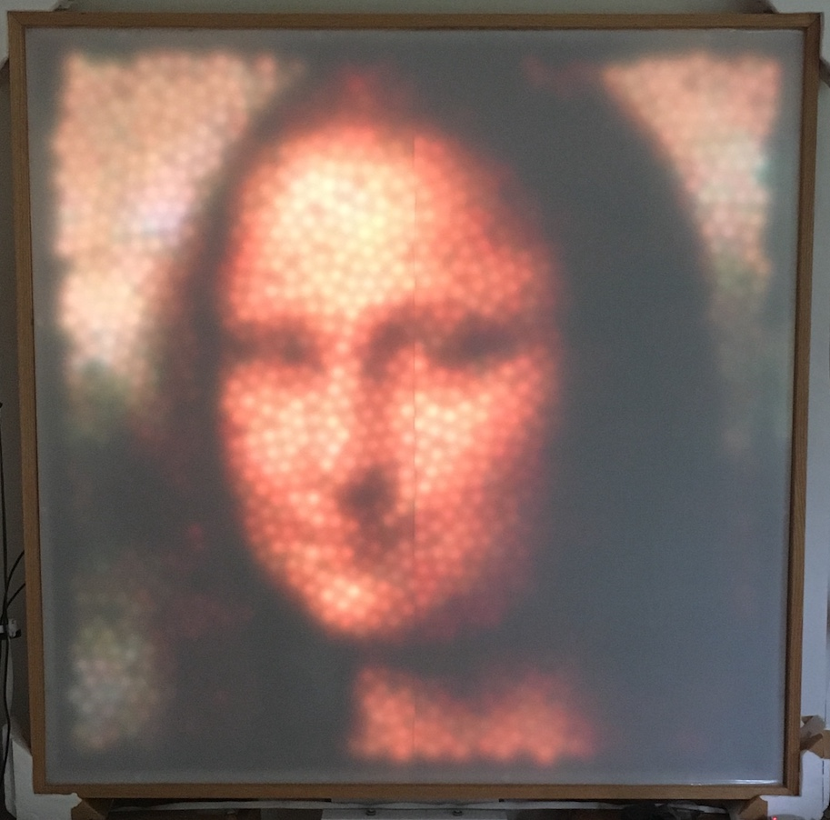

# display1593

Python code for a Raspberry Pi controlling the irregular 1593-LED display.

## Design

The display is approximately 4 ft by 4 ft (about 1.2 m by 1.2 m) and uses 1593 WS2811 RGB LEDs behind a translucent screen. The LEDs are arranged in an irregular pattern rather than a simple Cartesian grid, so the display driver must treat the LEDs as a flat list of addresses rather than as a conventional 2D image.

The LEDs are controlled by two Teensy 3.1 microcontrollers connected to a Raspberry Pi by USB.



This repository contains the code used on the Raspberry Pi to drive the display and to run example visualisation scripts.

## Package layout

The main display driver is now provided by the Python package in the `src/display1593` directory:

- `src/display1593/display1593.py` - the main display driver implementation
- `src/display1593/__init__.py` - exports the `Display1593` class

The repository also contains example scripts for displaying clocks, tests, and simulations.

## Quick start

Install the package in editable mode from the repository root:

```bash
pip install -e .
```

Example:

```python
from display1593 import Display1593

with Display1593() as dis:
    dis.clear_all()
    dis.set_led(0, (255, 0, 0))
    dis.show()
```

## Current projects in this repository

- `show_digclock.py` - displays a digital clock on the LED display
- `show_image.py` - displays a single image file on the LED display
- `play_frames.py` - plays a precomputed LED frame sequence (an `.npz`
  file, e.g. made from a video with
  [gen-video-frames](https://github.com/billtubbs/gen-video-frames)) in a
  loop: `python play_frames.py FRAMES.npz --fps 24`
- `schelling.py` - runs a Schelling segregation simulation on the display
- `fireplace/` - plays back precomputed fire animation frames
- `fluidsim/` - buoyancy-driven fluid flow simulation on the display
- `diagnostics/` - hardware, protocol and timing test scripts (run from
  the repo root), e.g. `check_led_neighbours.py`,
  `colour_balance_test.py`, `async_display_smoke_test.py`,
  `compare_modes.py`, `serial_worker_timing.py`, `comm_led_test.py`,
  `frame_display_speed_test.py`, `led_command_tests.py`

## Running digclock as a systemd service

To start the digital clock script automatically on boot, create a systemd service file at `/etc/systemd/system/myscript.service` with the following contents:

```ini
[Unit]
Description=Automatically launch Python script at startup
After=multi-user.target

[Service]
Type=idle
User=pi
WorkingDirectory=/home/pi/code/display1593
ExecStart=/usr/bin/python3 /home/pi/code/display1593/show_digclock.py
Restart=always
RestartSec=5

[Install]
WantedBy=multi-user.target
```

Then enable and start it with:

```bash
sudo systemctl daemon-reload
sudo systemctl enable myscript.service
sudo systemctl start myscript.service
```

### Check status and logs

```bash
sudo systemctl status myscript.service
sudo journalctl -u myscript.service -n 50
```

### Temporarily stop the service

To stop it for the current session only:

```bash
sudo systemctl stop myscript.service
```

To start it again later:

```bash
sudo systemctl start myscript.service
```

To watch the script's own log file:

```bash
tail -f /home/pi/code/display1593/show_digclock.log
```

### Troubleshooting: network drop-outs

With `--temp-colour`, a network outage doesn't stop the clock, but the
digits keep the colour of the last temperature fetched before the
outage, which can be hours out of date. To check for this, look in
`show_digclock.log`:

- one `HH:MM` line per minute: the clock itself is running (a gap means
  it stopped or restarted);
- `Outdoor temperature X C (observed ...)` about once an hour: fetches
  are working;
- `Outdoor temperature update failed: ...` every 5 minutes: the Pi
  can't reach the weather service. `Temporary failure in name
  resolution` usually means the Pi has no network at all, not just a
  DNS problem.

```bash
grep -aE "update failed|Outdoor temperature|started" show_digclock.log | less
```

Use `grep -a`: an unclean power-off can leave zero bytes in the log, and
without `-a` grep then stops printing matches at that point (it reports
`binary file matches` instead), hiding everything after it.

The log rotates at 256 KB with two backups (`.log.1`, `.log.2`), about a
week of history in total.

**Keep the system journal across reboots.** Raspberry Pi OS keeps the
systemd journal in memory only
(`/usr/lib/systemd/journald.conf.d/40-rpi-volatile-storage.conf`), so
rebooting a Pi that has dropped off the network erases the Wi-Fi/DHCP
messages that would explain why. To override it:

```bash
sudo mkdir -p /etc/systemd/journald.conf.d
printf '[Journal]\nStorage=persistent\nSystemMaxUse=50M\n' | \
  sudo tee /etc/systemd/journald.conf.d/50-persistent.conf
sudo systemctl restart systemd-journald
sudo journalctl --flush
```

Then, after an outage (`-b -1` = the previous boot, if you rebooted):

```bash
journalctl -b -1 | grep -iE "dhcp|lease|wlan0|NetworkManager"
nmcli -f DHCP4,IP4 device show wlan0   # current lease time and expiry
```

#### Cause found (November 2026): NetworkManager's address conflict check

From October to early November 2026 the Pi dropped off the network on a
regular 45 h cycle: about 24 h after getting a new DHCP lease it lost its
IP address, then got it back by itself 21 h later. During an outage the
router still listed the Pi as connected at 192.168.1.72, but nothing
answered there (no ping or ssh, and no ARP entry on the router or the
Mac), and the clock logged `Temporary failure in name resolution`. The
Wi-Fi link itself stayed up: the router's hourly key renewals kept
completing.

The persistent journal showed the same sequence every cycle:

1. The router's DHCP lease is 24 h (`dhcp_lease_time = 86400`), so
   NetworkManager renews it every 12 h.
2. ~40 min after each new lease, and right after every renewal,
   NetworkManager logged
   `conflict detected for IP address 192.168.1.72 with host 00:00:00:00:00:00`.
   This is its IPv4 address conflict detection (RFC 5227 ARP probing).
   No real device has an all-zero hardware address, so these are false
   alarms; where the replies come from (the router, or the Wi-Fi chip's
   ARP offload firmware) isn't known.
3. Around the 24 h renewal the address was removed from `wlan0`, while
   NetworkManager still considered the lease valid: the outage starts.
4. At 87.5% of the lease (21 h later), the DHCP rebind failed with
   `dhcp4 (wlan0): error -99 dispatching events` (-99 is EADDRNOTAVAIL:
   the address was no longer on the interface). NetworkManager then
   restarted the connection, got a fresh lease, and the Pi was back. That
   explains both the 24 h and the 21 h.

**Fix (2026-11-04):** turn off the conflict check for the Wi-Fi
connection (`ipv4.dad-timeout 0`). It only protects against another
device using the same address, which can't happen here: the router
assigns the address. Wi-Fi power saving was turned off at the same time
(`802-11-wireless.powersave 2`, 2 = disable): it isn't implicated in the
drops, but it made ssh laggy (ping to the Pi averaged 18 ms with spikes
to 65 ms; afterwards 6.6 ms, at most 22 ms; the router is ~1 ms).

```bash
sudo nmcli connection modify netplan-wlan0-Theseus \
  ipv4.dad-timeout 0 802-11-wireless.powersave 2
nmcli -g ipv4.dad-timeout,802-11-wireless.powersave \
  connection show netplan-wlan0-Theseus    # expect: 0, disable
sudo nmcli connection up netplan-wlan0-Theseus
```

To check that it's holding (no `conflict detected` or `error -99` lines,
only `new lease` about every 12 h, and no new `update failed`):

```bash
journalctl -b | grep -E "conflict detected|error -99|new lease"
grep -a "update failed" ~/code/display1593/show_digclock.log | tail -3
```

#### Second Wi-Fi adapter (USB dongle) disabled

A USB Wi-Fi dongle (Ralink RT5370, driver `rt2800usb`, `00:0f:60:0c:1d:82`)
is still plugged into the USB hub from before the Pi Zero 2 W, which has
built-in Wi-Fi (Broadcom, driver `brcmfmac`, `88:a2:9e:91:5c:e4`). The
connection only ever used the built-in adapter, so the dongle wasn't the
cause of the drops, but with two adapters the names `wlan0`/`wlan1`
swapped between boots (the connection profile is named
`netplan-wlan0-Theseus`), and the dongle shared the USB hub with the
Teensy boards. Its driver is now blocked, so the built-in adapter is
always `wlan0` (the dongle can stay plugged in; delete the file and
reboot to undo):

```bash
echo "blacklist rt2800usb" | \
  sudo tee /etc/modprobe.d/blacklist-rt2800usb.conf
sudo reboot
ip -br link    # only lo and wlan0
```

#### Pi network settings to reapply after a reinstall

- persistent journal (above)
- `/etc/modprobe.d/blacklist-rt2800usb.conf` (while the dongle is
  plugged in)
- `ipv4.dad-timeout 0` and `802-11-wireless.powersave 2` on the Wi-Fi
  connection

See `TODO.md` for the follow-up checks.

## Playing animations: pipelined mode

By default every driver call is synchronous: each command is sent to the
boards and acknowledged before the call returns, and `show()` displays
the LED values you've just set. That's simple, but for animations that
update most of the display every frame, the Pi spends much of each frame
waiting on the serial link instead of computing the next one.

Pipelined mode overlaps the two. While your script builds frame *k+1*,
background threads (one per board) send frame *k* to the Teensys. It's
switched on with `Display1593(pipelined=True)`, or `dis.start_pipeline()`
after connecting.

### How `show()` works in each mode

`show(t=None)` takes an optional show time `t`, a `time.monotonic()`
value. With no `t`, the frame is shown as soon as possible.

| | Synchronous (default) | Pipelined |
|---|---|---|
| Which frame `show()` displays | The LED values just set | The frame set *before the previous* `show()` call |
| `show()` returns | After both boards have acknowledged | Immediately (see below) |
| `show(t)` | Waits until `t`, then shows | Schedules the show for `t`, then returns |

**In pipelined mode, every `show()` call displays the previous frame.**
Each call does two things:

1. Schedules the show command for time `t`. At `t`, the boards display
   the frame that has already been sent to them.
2. Starts sending the frame you've just set, ready to be displayed by the
   *next* `show()` call.

So the first frame appears at the second `show()` call. To display the
last frame, call `flush()` (or `flush(t)`) at the end. Leaving the
`with` block also flushes, but shows the last frame immediately.

Frame *k*'s data has the whole interval between the two show times to
reach the boards, however late in the frame your script made the call.

Timeline at 1 frame per second, starting at t = 0:

| Time | Your script | Boards |
|---|---|---|
| 0 to 1 | Sets frame 1, calls `show(1)` | Idle |
| 1 | | Nothing to display yet. Frame 1 starts sending |
| 1 to 2 | Sets frame 2, calls `show(2)` | Receiving frame 1 |
| 2 | | Display frame 1. Frame 2 starts sending |
| 2 to 3 | Sets frame 3, calls `show(3)` | Receiving frame 2 |
| 3 | | Display frame 2. Frame 3 starts sending |

Some details:

- **Set methods don't send anything.** `set_leds()`, `set_all_leds()`,
  `clear_all()` etc. stage their commands on the Pi until the next
  `show()` call, and return immediately.
- **Both halves update together.** At each show time, each board's
  thread waits until both boards have received the frame, then both send
  the show command.
- **Late frames are logged.** If a board hasn't finished receiving its
  frame by `t`, a warning names it, and the frame is shown as soon as both
  boards are ready. A `show(t)` call made after `t` has already passed is
  also logged.
- **Pacing is built in.** `show()` returns immediately unless
  `max_frames_ahead` (default 2) earlier `show()` calls are still waiting
  for their show time. In that case it waits, so your script can't get
  far ahead of the display.
- **Errors are raised.** If a board stops replying, the next `show()` or
  `flush()` raises the error (e.g. `TimeoutError`).

### Quick start: scrolling rainbow

```python
import time

import numpy as np

from display1593 import Display1593

FPS = 20
N_FRAMES = 200
BRIGHTNESS = 64  # peak intensity per channel, 0-255

with Display1593(pipelined=True) as dis:
    # Horizontal position of each LED, scaled to 0-1.
    x = dis.leds.centres_x / dis.leds.centres_x.max()
    rgb_offsets = np.array([0, 1 / 3, 2 / 3])

    t_show = time.monotonic() + 0.1
    for k in range(N_FRAMES):
        # Rainbow that scrolls sideways: each channel is a cosine of
        # position + time, phase-shifted by a third of a cycle.
        phase = x[:, None] + k / 100 - rgb_offsets
        rgb = BRIGHTNESS * (0.5 + 0.5 * np.cos(2 * np.pi * phase))
        dis.set_all_leds(rgb.astype(np.uint8))

        # Show the *previous* frame at t_show, and start sending this one.
        dis.show(t_show)
        t_show += 1 / FPS

    # Show the last frame on schedule (leaving the with block would
    # otherwise show it immediately).
    dis.flush(t_show)
```

The same loop works in synchronous mode (`Display1593()`): there,
`show(t_show)` waits until `t_show` and shows the frame just set, so
every frame appears one frame earlier and `flush()` does nothing.

### Not yet done

- `play_frames.py` and `fireplace/` use pipelined mode; `fluidsim/`
  doesn't yet, though it also updates most of the display every frame.
- The show command still goes to each board separately. A planned
  firmware change will send it to TEENSY1 only, which will trigger
  TEENSY2 over the GPIO sync wire between the boards (see the TODOs in
  `display1593.py`).

## Colour correction and brightness

The LEDs' perceived brightness isn't linear in their 0-255 PWM values,
and red, green and blue aren't equally bright at the same value. The
display is for indoor use, so scripts normally use only a fraction of
the PWM range (roughly 0-64, a bit more for something with few lit
LEDs like the clock).

`display1593.colour_correction` maps a requested intensity per channel
(0-255, in perceived terms: equal steps look evenly spaced and equal
values look equally bright across colours) to PWM values, at one of 8
calibrated brightness settings (0-7):

```python
from display1593.colour_correction import apply_colour_lut, colour_lut

lut = colour_lut(brightness=3)
dis.set_all_leds(apply_colour_lut(rgb, lut))  # rgb: (1593, 3) uint8
```

Peak PWM values range from about 41 (red), 49 (green), 80 (blue) at
setting 0 to 110, 129, 214 at setting 7 (each step is x1.15). Settings
outside 0-7, including negative and fractional ones, extrapolate the
same scales. Using it is optional: a script can always send PWM values
directly.

For shapes with anti-aliased (partly lit) edges, use the table only for
the shape's colour, and scale the result linearly by each LED's
coverage:

```python
from display1593.colour_correction import apply_coverage

peak = apply_colour_lut(colour, lut)  # colour: (3,), 0-255
dis.set_leds(idx, apply_coverage(peak, coverage))  # coverage: 0-1
```

Light from neighbouring LEDs adds up linearly on the screen, so an LED
half covered by a shape should give half the light. Putting coverage
through the table (perceived intensity) gives far less light at the
edges: the clock's digits looked thin, with gaps between segments.

The scales come from a by-eye calibration on the display, first done
in 2016 (`coltest.py` in the old repo) and re-checked in November 2026
with `diagnostics/colour_balance_test.py`, which shows 8 colour bars x
32 levels at any brightness setting. The 2016 scales still looked
balanced, except that red's brightest levels were slightly too bright;
a red gain of 0.9 (`DEFAULT_GAINS`) fixed that.

`show_digclock.py` always uses it for the digit colour (with linear
coverage for the edges), so every digit colour looks equally bright. Its day/night cycle (`BCYCLE`) is now a brightness setting per
hour: 7 in the middle of the day, 5, 1, then -2 and -3 at night (below
the calibrated range). These were chosen (November 2026) to give peak
red values (110, 83, 48, 31, 27) close to the clock's earlier PWM
divisor cycle (127, 85, 51, 31, 28), and haven't been tuned by eye yet.
`--brightness N` fixes the setting for every hour instead.

## Light sensor (not supported yet)

The display has a photoresistor facing into the room, away from the
screen, so it measures the room's light level rather than the
display's. The plan is to map its reading to the brightness settings
above, so scripts can adjust their brightness automatically.

The original (2016-2019) firmware,
`led-display-project/serial_read_1593/serial_read_1593.ino`, read it
on TEENSY1 only, with `analogRead(PHOTORES)`, `PHOTORES = 3` (analog
input A3, pin 17 on a Teensy 3.1). The protocol was unframed: the host
sent the single byte `B`, and the board replied with 2 bytes, the
10-bit reading (0-1023, higher = brighter) big-endian; TEENSY2 replied
`0x00 0x00`. The old driver's `Display1593.getBrightness()` sent `B`
and returned `int.from_bytes(ser.read(2), "big")`.

In October 2019, logged once a second (`lightlevels.py`, analysed in
the old repo's `Look-at-light-sensor-data.ipynb`), readings ranged
from about 2 to 160 (smoothed): about 3.6 at night with the room
lights off (3.7 was taken as the "dark" threshold), hourly means of
about 15 at 8 am and 94 at 9 am. So indoors, the sensor uses only the
bottom of its range.

The current firmware (`CommLEDTest/src/main.cpp`) doesn't support it
yet: `led_commands.md` in `ser-comm-py` reserves the command `GB`
("Get the brightness reading from photoresistor"), with no response
format defined, but `main.cpp` has no `GB` handler and no longer
defines `PHOTORES`, so `GB` gets the "Invalid command" debug message.
See TODO.md for the planned changes.

## Current development focus

The current work focuses on improving the display driver API, making the example scripts work cleanly with the newer package layout, and improving reliability for long-running display applications on the Raspberry Pi.
